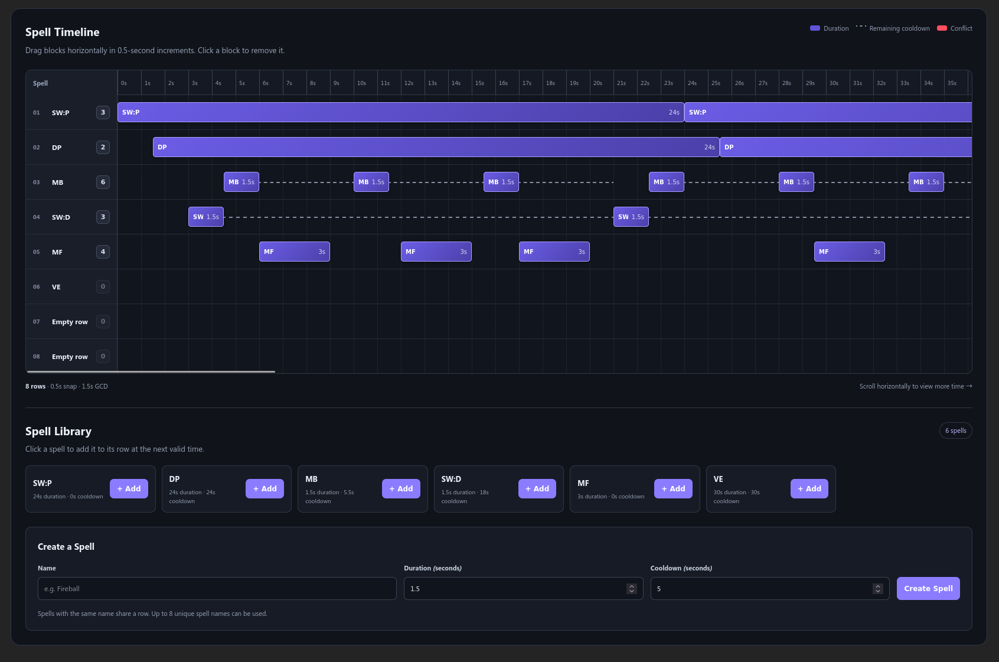

# Fictional Rotation Planner

Tool for planning rotations in WoW

## Running/Development

To install dependencies:

```bash
bun install
```

To start a development server:

```bash
bun dev
```

To run for production:

```bash
bun start
```

## Usage

Add spells/abilities at the bottom. Set their duration and cooldown. For now, treat cast time and effect time (such as DoT) as the same - i.e. duration.

There is an implicit 1.5s GCD.

Cast times will maybe be coming later. But for now this gives flexibility to be able to interrupt your channeled spells, or see when a spell you're casting is going to collide with the GCD of something more important.


